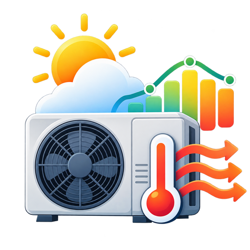

<p align="center">
  
</p>

# Heat Pump Forecast Optimizer

A Home Assistant custom integration that shifts **space heating** and
**domestic hot water production** toward warmer forecast hours.

It is especially useful for **air-source heat pumps with underfloor heating**,
where the building and screed can be used as a thermal buffer.

> This project is not affiliated with or endorsed by Daikin.

## Main idea

Instead of replacing the heat pump's own weather-compensated heating curve,
the integration can adjust a writable **heating-curve / leaving-water offset**.

For a Daikin Altherma setup this can look like:

```text
climate.altherma_leaving_water_offset
```

The heat pump continues to decide the actual leaving-water temperature. The
optimizer only moves the offset, for example from a base value of `-4` toward
`-3`, `-2` or `-1` during favorable forecast hours.

Domestic hot water can be controlled through:

```text
water_heater.altherma
```

The reduced DHW target delays re-heating; it does not actively cool the tank.

## Forecast logic

The integration:

1. Reads an hourly forecast from any Home Assistant `weather.*` entity.
2. Finds the warmest contiguous daytime block.
3. Finds the following night minimum.
4. Calculates the temperature advantage.
5. Selects a conservative heating-offset boost.
6. Optionally checks a room-temperature sensor before pre-heating.
7. Moves DHW re-heating into the favorable warm window.

Default boost example:

| Warm-window advantage vs. next night | Offset increase |
|---|---:|
| below 3 K | 0 K |
| 3 to <6 K | +1 K |
| 6 to <9 K | +2 K |
| 9 K or more | +3 K |

With a base offset of `-4`, a strong forecast advantage therefore results in a
temporary target of `-1`.

## Default Daikin example

The setup screen is pre-filled with the entity IDs used by a common Daikin
Altherma Home Assistant setup:

```text
climate.altherma_leaving_water_offset
water_heater.altherma
```

They remain fully editable.

Recommended starting values:

```text
Base heating offset:        -4
Maximum boost:              +3 K
Warm window:                 3 h
Day window:                  09:00 - 18:00

DHW normal target:          50 °C
DHW reduced target:         45 °C
DHW comfort minimum:        43 °C
DHW hygiene guard:          55 °C
```

## DHW safety behavior

The integration **does not change the operation mode** of the water heater.

If the tank falls below the configured comfort minimum, the normal DHW target
is restored immediately.

If Home Assistant sees either:

- a DHW target at or above the configured hygiene guard threshold, or
- operation mode `performance`

the optimizer will not lower the DHW target. This is intended to avoid
interfering with a hygiene cycle or manual boost.

Keep the heat pump manufacturer's own safety, frost-protection and hygiene
functions enabled.

## Room-temperature guard

A room-temperature sensor is optional.

If configured:

- at `target + upper margin`, forecast pre-heating is suppressed;
- below `target - lower margin`, at least one boost step is allowed while the
  favorable forecast window/ramp is active.

This helps avoid overheating a well-insulated home or underfloor-heating slab.

## Weather forecast

The integration uses Home Assistant's standard `weather.get_forecasts` action,
so it is not tied to one weather provider.

**Open-Meteo** is a convenient choice because Home Assistant supports it
directly and it provides hourly forecasts without an API key.

## Entities created

### Switch
- Automatic control

### Sensors
- Status
- Forecast temperature
- 24 h forecast minimum / maximum
- Optimal window start / end
- Optimal window mean temperature
- Next night minimum
- Temperature advantage
- Optional room temperature
- Planned heating offset
- DHW current temperature
- Planned DHW target

### Binary sensors
- Forecast boost active
- Temperature ramp active
- DHW comfort fallback
- DHW hygiene guard

## Status values

Typical states are:

```text
deaktiviert
wartet_auf_zeitfenster
temperatur_rampe
optimales_zeitfenster
basisbetrieb
warmwasser_komfort
hygiene_oder_manueller_boost
forecast_nicht_verfuegbar
```

## Installation with HACS

1. Open HACS.
2. Add this GitHub repository as a **Custom repository**.
3. Select category **Integration**.
4. Install **Heat Pump Forecast Optimizer**.
5. Restart Home Assistant.
6. Go to **Settings -> Devices & services -> Add integration**.
7. Search for **Heat Pump Forecast Optimizer**.

## Manual installation

Copy:

```text
custom_components/heatpump_forecast_optimizer
```

to:

```text
/config/custom_components/heatpump_forecast_optimizer
```

Restart Home Assistant and add the integration from the UI.

## First start is safe

The master switch **Automatic control starts OFF**.

The integration will calculate forecast data and planned targets, but it will
not write anything to the heat pump until you explicitly turn the switch on.

This makes it possible to observe the proposed offsets and DHW targets first.

## Disable behavior

By default, switching automatic control off restores:

- the configured base heating offset;
- the configured normal DHW target.

A detected hygiene/manual high-temperature DHW target is not lowered during
disable.

This restore behavior can be disabled in the integration options.

## Local brand icon

Home Assistant 2026.3+ supports brand files shipped directly by custom
integrations. This repository contains:

```text
custom_components/heatpump_forecast_optimizer/brand/icon.png
custom_components/heatpump_forecast_optimizer/brand/icon@2x.png
custom_components/heatpump_forecast_optimizer/brand/logo.png
custom_components/heatpump_forecast_optimizer/brand/logo@2x.png
```

## License

MIT
